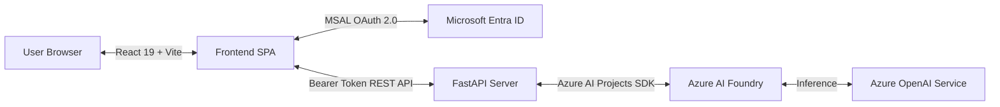

# 🛡️ Azure AI Text Analysis & Privacy Agent

An enterprise-grade text intelligence and privacy platform powered by **Azure AI Foundry**, **Azure OpenAI**, **FastAPI**, and **React.js**. 

Built to automate sensitive data compliance (PII redaction), Named Entity Recognition (NER), sentiment intelligence, and conversational language assistance through a modern monochrome interface.

[](https://fastapi.tiangolo.com/)
[](https://react.dev/)
[](https://azure.microsoft.com/)

---

## ✨ Key Features

- 🔒 **Automated PII Redaction:** Identifies and redacts sensitive personal information (names, emails, phone numbers, credit card numbers, addresses) into compliance tokens like `[Person]`, `[Email]`, or `[Phone Number]`.
- 🏷️ **Named Entity Recognition (NER):** Extracts, categorizes, and formats entities into Persons, Organizations, Locations, and Identifiers with structured markdown views.
- 📊 **Sentiment Intelligence:** Provides polarity scoring, confidence metrics, key emotional drivers, and executive summaries.
- 💬 **Interactive Chat Assistant:** Multi-turn conversational interface for querying, summarizing, and interrogating uploaded documents.
- 🔐 **Zero-Trust Security & Keyless Authentication:** 
  - Token-based access delegation using **Microsoft Entra ID (MSAL OAuth 2.0)**.
  - 100% keyless architecture—never requires or stores Azure API keys.
  - Multi-tenant support allowing users from any Azure subscription to bring their own AI Foundry resources.

---

## 🏗️ Architecture & Tech Stack



- **Frontend:** React 19, Vite, Lucide Icons, Modern Monochrome CSS Design System.
- **Backend:** FastAPI, Python 3.10+, Uvicorn, Pydantic.
- **Cloud & AI:** Azure AI Foundry SDK (`AIProjectClient`), Azure OpenAI Service.
- **Security & Identity:** Microsoft Entra ID (MSAL), OAuth 2.0 Bearer tokens, Token Claim Validation.

---

## 🔐 Azure Prerequisites & Bring-Your-Own-Azure (BYOA) Guide

This application features a **100% keyless architecture** powered by **Microsoft Entra ID (MSAL OAuth 2.0)**. Anyone with an Azure account can connect and run inferences against their own Azure AI Foundry or Azure OpenAI resources.

### Step 1: Assign the Required Azure RBAC Role
When accessing Azure AI models with a Microsoft account (without an API key), Azure requires an explicit data-plane role assignment on your resource:
1. Open the [Azure Portal](https://portal.azure.com).
2. Navigate to your **Azure AI Foundry / Cognitive Services** resource.
3. In the left navigation menu, select **Access Control (IAM)**.
4. Click **+ Add** -> **Add role assignment**.
5. Search for and select the role **Cognitive Services OpenAI User** (or *Cognitive Services OpenAI Contributor*).
6. Under **Members**, select **User, group, or service principal**, click **+ Select members**, and pick your **signed-in Microsoft / Azure account**.
7. Click **Review + assign** to save.

> [!IMPORTANT]
> Without this role assignment, Azure's zero-trust security will reject the OAuth Bearer token with a 401/403 authorization error.

### Step 2: Retrieve Your Azure Target Details
From your Azure AI Foundry portal or Azure Portal:
* **Directory (Tenant) ID:** Found in the Microsoft Entra ID overview page or Azure subscription properties.
* **Foundry Endpoint:** Your project endpoint (e.g., `https://<your-resource>.services.ai.azure.com/` or `https://<your-resource>.openai.azure.com/`).
* **Model Deployment Name:** The exact name of your model deployment under **Deployments** (e.g., `gpt-4o`, `gpt-4`).
* **Agent Name:** The name of your custom agent created in Azure AI Foundry (e.g., `serene-agent-xxxx` or `Text-Analysis-Agent`).

### Step 3: Connect in the Application
1. In the sidebar, enter your **Directory (Tenant) ID** -> click **Sign In to Access** to authenticate with Microsoft.
2. Enter your **Foundry Endpoint**, **Model Deployment**, and **Agent Name**.
3. Click **Connect** (the button will turn to **`Connected ✓`**).
4. Select a task or open the Chat Assistant to run real-time AI inferences!

---

## 🛠️ Local Setup Instructions

### 1. Clone the Repository
```bash
git clone https://github.com/PranavHotha/azure-text-analysis-agent.git
cd azure-text-analysis-agent
```

### 2. Backend Setup
```bash
# Create and activate virtual environment
python -m venv venv
.\venv\Scripts\activate   # On Linux/macOS: source venv/bin/activate

# Install dependencies
pip install -r requirements.txt

# Start FastAPI server
python -m uvicorn server:app --host 127.0.0.1 --port 8000 --reload
```

### 3. Frontend Setup (Development Mode)
```bash
cd text-agent-app
npm install
npm run dev
```
Open your local development server in your browser.

---

## 📄 License
This project is licensed under the MIT License - see the [LICENSE](LICENSE) file for details.
