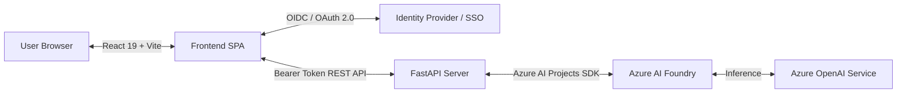

# 🛡️ Azure AI Text Analysis & Privacy Agent

An enterprise-grade text intelligence and privacy platform powered by **Azure AI Foundry**, **Azure OpenAI**, **FastAPI**, and **React.js**. 

Built to automate sensitive data compliance (PII redaction), Named Entity Recognition (NER), sentiment intelligence, and conversational language assistance through a modern monochrome interface.

[](https://fastapi.tiangolo.com/)
[](https://react.dev/)
[](https://azure.microsoft.com/)

---

## 📸 Application Preview

### 1. User Interface & Workspace Design
| Studio Workspace | Conversational Assistant |
| :---: | :---: |
|  |  |

### 2. Live Task Execution & AI Output
| Sample Analysis in Action |
| :---: |
|  |

---

## ✨ Key Features

- 🔒 **Automated PII Redaction:** Identifies and redacts sensitive personal information (names, emails, phone numbers, credit card numbers, addresses) into compliance tokens like `[REDACTED_EMAIL]` or `[REDACTED_PHONE]`.
- 🏷️ **Named Entity Recognition (NER):** Extracts, categorizes, and formats entities into Persons, Organizations, Locations, and Identifiers with structured JSON and markdown views.
- 📊 **Sentiment Intelligence:** Provides polarity scoring (-1.00 to +1.00), primary emotion classification, key emotional drivers, and executive summaries.
- 💬 **Interactive Chat Assistant:** Multi-turn conversational interface for querying, summarizing, and interrogating uploaded documents.
- 🔐 **Zero-Trust Security & Authentication:** 
  - Token-based access delegation using **OpenID Connect (OIDC)** and **OAuth 2.0**.
  - Ephemeral in-memory session configuration—endpoints and deployment keys are never stored on disk.
  - Model execution is protected and gated to authenticated user sessions.

---

## 🏗️ Architecture & Tech Stack



- **Frontend:** React 19, Vite, Lucide Icons, Modern Monochrome CSS Design System.
- **Backend:** FastAPI, Python 3.10+, Uvicorn, Pydantic.
- **Cloud & AI:** Azure AI Foundry SDK (`AIProjectClient`), Azure OpenAI Service.
- **Security & Identity:** OpenID Connect (OIDC), OAuth 2.0 Bearer tokens, Token Claim Validation.

---

## 🛠️ Local Setup Instructions

### 1. Clone the Repository
```bash
git clone https://github.com/PranavHotha/azure-text-analysis-agent.git
cd azure-text-analysis-agent
```

### 2. Backend Setup
```bash
# Create and activate virtual environment
python -m venv venv
.\venv\Scripts\activate   # On Linux/macOS: source venv/bin/activate

# Install dependencies
pip install -r requirements.txt

# Start FastAPI server
python -m uvicorn server:app --host 127.0.0.1 --port 8000 --reload
```

### 3. Frontend Setup (Development Mode)
```bash
cd text-agent-app
npm install
npm run dev
```
Open [http://localhost:5173](http://localhost:5173) in your browser.

---

## 📄 License
This project is licensed under the MIT License - see the [LICENSE](LICENSE) file for details.
